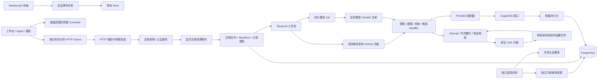

# 解耦后的模块边界

基线为 `62084d5`。采用模块化单体，保留现有部署和事务；没有新增微服务。

## 模块及数据责任

以 `modules.json` 定义公共接口、主要写表和禁止依赖；既有 24 域功能清单继续由仓库共享审查映射维护。这里不建立第二套功能账本。

- 身份：认证、登录节流和角色判断复用同一服务，CAD 与监控保留各自 HTTP 入口。
- 文档：`document_operations` 处理授权和受理；`workflow_admission` 显式组合任务记录、文档队列与重放事件。调用方在同一个事务内持久化分发意图。
- 执行：`run_state` 管理任务、步骤与 Attempt；`model_jobs` 管理模型调用资格；`model_fence` 在事务入口校验资格。受理、提交与终态清理仍有事务边界。
- Agent 与 CAD：Handler 按规划、源代码、原生操作、执行、几何/视觉/DFM、BOM、候选和审核划分。编排名称、参数及 patch 保持兼容。
- Provider：依赖用量接口；生产装配仍使用真实数据库采集，不存在空 Sink。采集的特殊取消后写入只有显式允许的用量模块可以绕过 Job 栅栏。
- 前端：Clients 不依赖 UI/Store。参数编辑明确接收所属面板的持久任务上下文。WebSocket 连接维护与消息业务分发分开，保留现有事件归属和 Store。
- 监控：认证数据库连接与查询连接可分别配置；查询角色不可访问凭据/请求正文或修改数据。`MONITOR_DATABASE_URL` 未配置时维持旧部署兼容，通过只读角色限制查询。

## 兼容入口

`engineeringService.ts`、`api/error_messages.py`、`workflows/model_job_policy.py` 和 `workflows/activities.py` 保留旧导出。业务消费者已迁移到对应模块；工作流包装保留原 Activity 名称。不能只因文件缩短而删除历史入口。

原生修改 DTO 位于 `models/native_modification.py`，HTTP DTO 不再反向依赖 Temporal 提交服务；旧导入位置继续重导出。

## 验证与限制

`check_boundaries.py` 检测 Python 顶层/局部/相对导入及 TypeScript 导入、重导出和动态导入；禁止新增越界和未经允许的栅栏绕过。当前违规基线为空。

它不是完整 SQL/动态调用图证明。跨域授权、事务原子性、代次资格与草稿身份继续依赖真实数据库、Temporal、原生内核及浏览器测试；不得用静态检查替代。

CI 的 `Regression gate` 汇总后端、前端、真实运行时和架构检查。专项 JUnit 缺失、零测试、跳过或失败均不能通过专项证据检查。真实 Provider 凭据不放进仓库：无凭据 CI 运行实际内核和受控 Provider 测试，真实 Provider 验收单列。

## 运行与撤回

解耦基线的数据库版本为 `0030_model_job_json_numbers`；当前开发代码增加 `0031_provider_budgets`，用独立表保存准入策略、预留、账户与结算事件。不得为了应用回滚删除预算记录或改写在途任务；升级与旧应用兼容仍须通过生命周期回归。本地源码版本不代表生产部署版本。

发布前检查同时读取在途任务的持久预算合同版本，并在目标镜像内核对支持情况。Temporal 历史可回放不代表旧 Activity/Model Job 执行器支持账本；旧镜像不支持时先在当前版本完成或取消任务，再回滚。仍需暂停准入、排空运行中的任务和停止 Worker 后复查，不支持绕过该流程混跑旧 Worker。

### 原生可靠性修复的实现边界

- R01/T07b 在现有 Workflow 内增加版本化阶段计数与任务总额度，保留对象级原生修复预算和既有历史分支。恢复与检查点不能重新授予额度。
- R02 新任务使用 v2 比较合同，支持 eq/ge/le/range 与有来源的非对称工程公差；v1 序列化与回放不变。需求绑定采用可核验的有限语法、已保存确认和已提交版本的独立测量。尚不能证明的自然语言关系返回 `engineering_verification_unavailable`，不能把“原文含数字”当成语义覆盖。
- R03 的工具说明和示例以实际 Schema 为准，包含 `point_on_object`；未扩展执行白名单。
- R04 继续区分五类可执行减料与 Pocket/Hole 的受控修复能力。没有安全补丁路径时报告软件能力边界，不能归因用户缺少尺寸。
- R05 的空裁剪与内核失败独立分类。只读绑定覆盖冻结 world/bounds 坐标，以及服务器确认的单一 Body/App::Link 局部轴：冻结对象身份，读取最终 FCStd 的刚体变换，独立验证该实体包含于最终 STEP。要求、坐标和原生文件不会被改写。真实旋转 Body/Link 和修改后提交正反例已验证；缩放 Link、多对象或子元素选择及未绑定的对象指代会明确拒绝，不能解释为任意自然语言选区已支持。
- R06 显式实体数使用已经绑定的验收条件，不再叠加默认单实体限制；未明确多实体的普通零件保留单实体策略，装配、导入和恢复沿用各自规则。
- R07 默认 `PROVIDER_BUDGET_MODE=requests`，不声称硬费用上限。`hard_cost` 必须配置 `PROVIDER_BUDGET_COST_CONTRACT`：模型/币种、任务和租户月额度、输入输出价格、官方价格与边界来源及版本、有效期、完整输入上界与推理包含在内的输出上界。当前仅核验 Moonshot `kimi-k2.7-code`、CNY、262144 输入 token 与至少 32768 输出 token；派发前实际设置 `max_tokens`，未知回执保留预留，统计日志失败不绕过准入。定价来源为 [官方模型页](https://platform.kimi.com/)，输出边界来源为 [思考模型说明](https://platform.kimi.com/docs/guide/use-thinking-models)；运维需重新核实并设置有限有效期，源码没有默认价格授权。
- V01 使用矩形驱动约束的原生表达式保留孔中心关系。V02 的草图半径反例未复现阻断，Part::Cylinder 半径也不在参数面板白名单内；进一步核对最终 STEP 发现，沉孔的孔径 4→10 先于孔口直径 8→12 时，FreeCAD 1.1.3 会把未要求修改的沉孔深度 3 改成 9。这是原生属性自动改值，不能用“执行成功”判为通过。结构化编译对已验证的 Hole 尺寸对先校验最终大小关系，再在需要扩大孔口时先改孔口；原生入口拒绝会触发自动改值的单独孔径操作。与原方案的调整原因是该反例存在合法逐步顺序，可沿用单步校验、失败回滚与操作账本，无须新增通用原子编辑接口或扩大白名单。内核自动改值依据见 [FreeCAD 1.1.3 Hole 实现](https://github.com/FreeCAD/FreeCAD/blob/1.1.3/src/Mod/PartDesign/App/FeatureHole.cpp#L842)。
- E01 复用 `ci-live-cases.json` 与 `scripts/ci/live_contract.py`，`--suite mainline` 运行同一零件的新建及三轮修改，前一轮失败即停止轨迹，独立检查预先冻结的几何期望。报告保留失败/未开始轮次、真实预算和提交状态。单轨迹冒烟不代表总体成功率提升；付费评测仍是手动入口，不进入每个 PR 的确定性必跑项，预算不得自动扩大。

若配置独立监控查询账号，只授予 `cad_agent_monitor` 角色，不授予 `cad_agent_runtime`、`cad_agent_auth`、超级用户或 BYPASSRLS。监控认证仍使用原认证连接；部署凭据通过现有环境机制注入。

GitHub 私有仓库套餐当前不支持分支保护（API 返回 403）。汇总 Gate 配置不等于服务端强制保护；套餐能力解决后，需设为必需检查并要求独立审查，再用失败 PR 验证无法合并。
