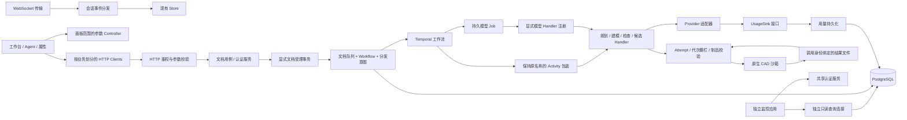

# 解耦后的模块边界

基线为 `62084d5`。采用模块化单体，保留现有部署和事务；没有新增微服务。

## 模块及数据责任

以 `modules.json` 定义公共接口、主要写表和禁止依赖；既有 24 域功能清单继续由仓库共享审查映射维护。这里不建立第二套功能账本。

- 身份：认证、登录节流和角色判断复用同一服务，CAD 与监控保留各自 HTTP 入口。
- 文档：`document_operations` 处理授权和受理；`workflow_admission` 显式组合任务记录、文档队列与重放事件。调用方在同一个事务内持久化分发意图。
- 执行：`run_state` 管理任务、步骤与 Attempt；`model_jobs` 管理模型调用资格；`model_fence` 在事务入口校验资格。受理、提交与终态清理仍有事务边界。
- Agent 与 CAD：Handler 按规划、源代码、原生操作、执行、几何/视觉/DFM、BOM、候选和审核划分。编排名称、参数及 patch 保持兼容。
- Provider：依赖用量接口；生产装配仍使用真实数据库采集，不存在空 Sink。采集的特殊取消后写入只有显式允许的用量模块可以绕过 Job 栅栏。
- 前端：Clients 不依赖 UI/Store。参数编辑明确接收所属面板的持久任务上下文。WebSocket 连接维护与消息业务分发分开，保留现有事件归属和 Store。
- 监控：认证数据库连接与查询连接可分别配置；查询角色不可访问凭据/请求正文或修改数据。`MONITOR_DATABASE_URL` 未配置时维持旧部署兼容，通过只读角色限制查询。
- 客户计费（M12）：`customer_billing` 管理版本化套餐、租户订阅与余额流水；provider 预留事务在发出新请求前检查客户额度。金额和费用日志分账，默认套餐保留旧限制。数据库版本为 `0033_tenant_billing_foundation`，支付接入和发布保护边界见 [租户隔离与套餐基础](customer-billing.md)。

## 兼容入口

`engineeringService.ts`、`api/error_messages.py`、`workflows/model_job_policy.py` 和 `workflows/activities.py` 保留旧导出。业务消费者已迁移到对应模块；工作流包装保留原 Activity 名称。不能只因文件缩短而删除历史入口。

原生修改 DTO 位于 `models/native_modification.py`，HTTP DTO 不再反向依赖 Temporal 提交服务；旧导入位置继续重导出。

## 验证与限制

`check_boundaries.py` 检测 Python 顶层/局部/相对导入及 TypeScript 导入、重导出和动态导入；禁止新增越界和未经允许的栅栏绕过。当前违规基线为空。

它不是完整 SQL/动态调用图证明。跨域授权、事务原子性、代次资格与草稿身份继续依赖真实数据库、Temporal、原生内核及浏览器测试；不得用静态检查替代。

CI 的 `Regression gate` 汇总后端、前端、真实运行时和架构检查。专项 JUnit 缺失、零测试、跳过或失败均不能通过专项证据检查。真实 Provider 凭据不放进仓库：无凭据 CI 运行实际内核和受控 Provider 测试，真实 Provider 验收单列。

## 运行与撤回

解耦基线的数据库版本为 `0030_model_job_json_numbers`；`0031_provider_budgets` 用独立表保存准入策略、预留、账户与结算事件，`0032_provider_receipt_recovery` 在预留记录上增加持久结算队列。模型响应必须先单独提交回执、完整响应与重试时间，才能在即时结算失败后返回成功；Model Job worker 自动补结算，包括已完成和已取消的任务。重复结算锁定同一预留及账户，不再发送模型请求；缺失用量仍保留预留，不推算免费。尚未持久化回执时的数据库故障不得报告任务成功；旧记录没有回执的预留无法凭空补结算。不得为了应用回滚删除预算记录或改写在途任务；存在待结算回执时，发布检查要求目标镜像支持 `provider-receipt-recovery.v1`，数据库降级也要求先清空待结算队列。升级与旧应用兼容仍须通过生命周期回归。本地源码版本不代表生产部署版本。

发布前检查同时读取在途任务的持久预算合同版本，并在目标镜像内核对支持情况。Temporal 历史可回放不代表旧 Activity/Model Job 执行器支持账本；旧镜像不支持时先在当前版本完成或取消任务，再回滚。仍需暂停准入、排空运行中的任务和停止 Worker 后复查，不支持绕过该流程混跑旧 Worker。

### 原生可靠性修复的实现边界

当前默认生成、修改链路按用户确认的职责调整，将保存的原文与确认字段交给模型解释；来源覆盖的前置规则和模型回复后的语义绑定门禁已移除。模型提出的合同仍须满足结构要求，并接受真实几何测量，但后端不会补齐模型遗漏的用户条件。以下有限语法说明描述保留的解析、预览和历史证据能力，不代表默认任务仍有这些来源覆盖保证；历史冻结合同和错误产物不能改写为通过。

- 来源谓词覆盖在已有有限语法上分开处理“发现要求”和“编译测量”：贯穿、穿透等原文条件先进入独立义务清单，只有同一来源范围的 `hole_through=1` 才能覆盖，孔径、孔数和孔深均不能替代；未支持的路径、目标和否定要求继续明确拒绝。常见中英文孔短语复用数量、孔径和贯穿语法，紧邻的完整孔主体可授权后续无其他修饰的直径；其他对象、混合主体和未知中间语句不继承。原始来源偏移及冻结合同保留，不宣称支持任意自然语言。
- `tests/fixtures/intake_1030_feedback.json` 单独保留 Excel 原文、单元格和文件摘要；`intake_1030_receipts.json` 保留历史任务输入与模型回复，任务编号相同不等于文本相同。`test_source_predicate_coverage.py` 使用独立编写的解析预期，原生专项检查不同尺寸、旋转、盲孔、缺孔和错孔径。真实服务专项核对原文进入 Model Job、模型合同不被改写、合同内几何条件失败不产生候选，以及正确模型审核提交；故意不完整的模型合同可能形成候选，回归用例通过审核入口拒绝它们并验证 Head 不变，不计为完整用户需求验收通过。
- F01 补修在动作词表之外独立登记工程主体后的完整谓词及句首强制条件（含须、需、要和编号列表）；已知数字不能覆盖未知动作或附加条件。明确的“孔须打通／孔要穿过整块板”等完整肯定句绑定 `hole_through=1`，板厚有唯一来源时沿用独立孔深测量。未能唯一确定的目标、外部安装对象、多部件歧义、否定和条件句保持拒绝，诊断持久保存原句。原始盲孔 STEP、原句正反工作流和浏览器提交重载纳入复验；历史冻结合同及验收记录不改写。
- 矩形壳体装配使用新增的有限验收能力 `rectangular_assembly_requirements` / `rectangular_assembly`：必须先由保存的用户输入明确总体尺寸包含装配盒体和上盖、不含安装耳。逐句建立部件尺寸与关系要求，未知或矛盾语句拒绝；孔位和孔槽归属不得由模型标签或目标尺寸选择。最终 STEP 的完整底面、相邻内壁与外壁确定局部坐标，实际外凸材料、连续矩形环槽和完整圆孔形成独立清单，按实测边界重建全部材料并检查双向差集。已枚举的孔槽明确进入缺料账本；额外盲孔、B 样条、缺口和通道不能通过忽略壁面内环放行。
- 装配证据分别覆盖盒盖贴合、四角安装耳、每耳一孔、孔轴居中、安装孔与内腔隔离、接合面连续密封槽、短侧接头孔居中与贯通；短侧孔的高度中心以装配后的整体高度为基准。尺寸不依赖建模原点或旋转方向，长宽为矩形主体的长短边；不把指定槽和孔之外的薄处豁免。此能力面向平面盖板、矩形开口腔、矩形安装耳和矩形连续环槽，无法证明的曲面、额外结构与歧义继续阻断，物理防水及打印性能仍以未验证事项保存。
- 两实体的要求在冻结前进入既有 `solid-count-policy.v1`，不得被模型的普通零件分类覆盖；装配 STL 通过独立 `solid` 块保留部件身份，网格清理只在各部件内部进行，接触处不得跨部件焊接或删面。每个部件仍须封闭；不移动、融合或修补几何来获取通过。新增正反例、接收端证据篡改检查、真实工作流审核/提交/回放与浏览器重载检查均接入既有 CI，旧合同的默认序列化保持不变。
- R01/T07b 在现有 Workflow 内增加版本化阶段计数与任务总额度，保留对象级原生修复预算和既有历史分支。恢复与检查点不能重新授予额度。
- R02 新任务使用 v2 比较合同，支持 eq/ge/le/range 与有来源的非对称工程公差；v1 序列化与回放不变。有限语法来源绑定保留为解析能力，默认任务的语义解释由模型负责。独立几何测量验证冻结合同中实际列出的条件，不能把合同通过或“原文含数字”当成完整来源覆盖。
- R02 来源角色补修：创建语句中的“一个设计”绑定为现有单文档交付事务，不推断为单实体，也不覆盖孔、支脚或多个设计的数量条件。外部桌板厚度作为 `source-context.v1` 输入保存；只有已保存的概念设计确认才能推导平面夹口净空下限（等值加正公差或区间上界），实物适配和夹持力仍标明未验证。外部尺寸不能测成挂钩自身厚度；未知语序、无上界、严格比较、其他未支持条件仍拒绝。合同、来源绑定、独立几何报告和浏览器重载保留该范围。没有新增上下文的历史 v2 合同保持原始序列化与摘要。与直接增加“25 mm 桌板 → 夹口等于 25 mm”快捷分支的差别是保留输入角色与推导关系，不冒充已经证明夹持功能。
- 确定无法绑定的 3D 来源在请求模型前检查；模型可修正的合同提案仍走原有反馈重试，DXF/SVG 保留独立路径。Model Job 将错误码与消息分开持久化，恢复时不重复拼接错误码。CI 增加首页挂钩原文的提交、概念确认、真实 FreeCAD、候选审核提交和刷新链路；控制规划输入的测试不计为真实 AI 成功率或实物适配验收。
- 发布兼容检查同时读取已保存的来源上下文版本，包括已完成任务的证据；目标镜像不能解码时阻止降级。完成在途任务并不能让旧版严格解码器自动支持新字段，禁止通过删除冻结上下文来回滚。
- 同进程的 Worker／浏览器回归暴露渲染模块导入时改写 `XDG_CACHE_HOME`，使 Linux Playwright 丢失已安装浏览器的位置。渲染器只设置专属 `MPLCONFIGDIR`，保留其他库的缓存目录；独立进程测试检查未配置和已配置的环境，并保留四视图真实渲染检查。
- 设计交付数量只能由请求主体授权，不能借用修饰语或安装位置中的产品名：“板上的孔”“加强筋放在板上”“板状加强筋”的数量仍待特征绑定，不得因出现“板”字而转成文档份数。相对修饰、位置关系和已有尺寸语法分别处理，原始挂钩及带已绑定孔数的板继续通过。
- R02 验收补修：通孔独立绑定为 `hole_through=1`，不再依赖是否给出板厚；以最终 STEP 的完整圆柱孔轴及实际孔径构造跨越实体边界的通路，布尔交集有材料即不通过，内核失败返回未验证。覆盖范围限于完整直圆孔，模型文件和冻结要求均不改写。孔径各语序复用同一比较、公差与区间解析，严格 `>`/`<` 仍按当前合同能力明确拒绝，不能偷偷改成 `eq` 或含等号的边界。未支持的否定表达（如 `not through`、`non-through`、`no through hole`）明确拒绝，不能忽略或反向绑定成通孔。这是在既有独立验收上补足语义，不扩展为任意自然语言几何证明。
- R03 的工具说明和示例以实际 Schema 为准，包含 `point_on_object`；未扩展执行白名单。
- R04 继续区分五类可执行减料与 Pocket/Hole 的受控修复能力。没有安全补丁路径时报告软件能力边界，不能归因用户缺少尺寸。
- R05 的空裁剪与内核失败独立分类。只读绑定覆盖冻结 world/bounds 坐标，以及服务器确认的单一 Body/App::Link 局部轴：冻结对象身份，读取最终 FCStd 的刚体变换，独立验证该实体包含于最终 STEP。要求、坐标和原生文件不会被改写。真实旋转 Body/Link 和修改后提交正反例已验证；缩放 Link、多对象或子元素选择及未绑定的对象指代会明确拒绝，不能解释为任意自然语言选区已支持。
- R06 显式实体数使用已经绑定的验收条件，不再叠加默认单实体限制；未明确多实体的普通零件保留单实体策略，装配、导入和恢复沿用各自规则。
- R07 默认 `PROVIDER_BUDGET_MODE=requests`，不声称硬费用上限。`hard_cost` 必须配置 `PROVIDER_BUDGET_COST_CONTRACT`：模型/币种、任务和租户月额度、输入输出价格、官方价格与边界来源及版本、有效期、完整输入上界与推理包含在内的输出上界。当前仅核验 Moonshot `kimi-k2.7-code`、CNY、262144 输入 token 与至少 32768 输出 token；派发前实际设置 `max_tokens`，未知回执保留预留，统计日志失败不绕过准入。定价来源为 [官方模型页](https://platform.kimi.com/)，输出边界来源为 [思考模型说明](https://platform.kimi.com/docs/guide/use-thinking-models)；运维需重新核实并设置有限有效期，源码没有默认价格授权。
- V01 使用矩形驱动约束的原生表达式保留孔中心关系。V02 的草图半径反例未复现阻断，Part::Cylinder 半径也不在参数面板白名单内；进一步核对最终 STEP 发现，沉孔的孔径 4→10 先于孔口直径 8→12 时，FreeCAD 1.1.3 会把未要求修改的沉孔深度 3 改成 9。这是原生属性自动改值，不能用“执行成功”判为通过。结构化编译对已验证的 Hole 尺寸对先校验最终大小关系，再在需要扩大孔口时先改孔口；原生入口拒绝会触发自动改值的单独孔径操作。与原方案的调整原因是该反例存在合法逐步顺序，可沿用单步校验、失败回滚与操作账本，无须新增通用原子编辑接口或扩大白名单。内核自动改值依据见 [FreeCAD 1.1.3 Hole 实现](https://github.com/FreeCAD/FreeCAD/blob/1.1.3/src/Mod/PartDesign/App/FeatureHole.cpp#L842)。
- E01 复用 `ci-live-cases.json` 与 `scripts/ci/live_contract.py`，`--suite mainline` 运行同一零件的新建及三轮修改，前一轮失败即停止轨迹，独立检查预先冻结的几何期望。报告保留失败/未开始轮次、真实预算和提交状态。单轨迹冒烟不代表总体成功率提升；付费评测仍是手动入口，不进入每个 PR 的确定性必跑项，预算不得自动扩大。

若配置独立监控查询账号，只授予 `cad_agent_monitor` 角色，不授予 `cad_agent_runtime`、`cad_agent_auth`、超级用户或 BYPASSRLS。监控认证仍使用原认证连接；部署凭据通过现有环境机制注入。

GitHub 私有仓库套餐当前不支持分支保护（API 返回 403）。汇总 Gate 配置不等于服务端强制保护；套餐能力解决后，需设为必需检查并要求独立审查，再用失败 PR 验证无法合并。
